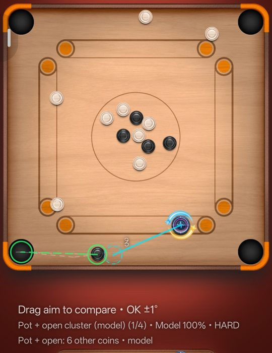
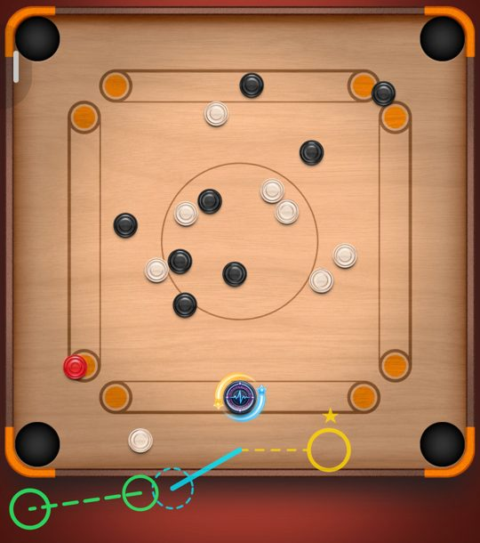
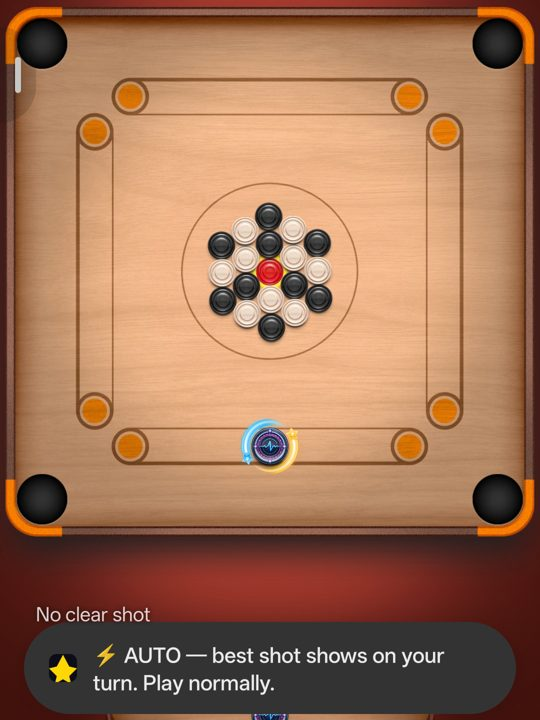

# BitAim — carrom aim assist

Android aim guidance for carrom, built with React Native, Java and OpenCV. BitAim reads the board from the screen, plans a route to a pocket, and draws it over the game. An optional auto-play mode can also take the shot.

Current version: **4.10.7** (branch `pc-link`). Stable release: **v4.9.11** (branch `main`, APK under *Releases*).

## Screenshots (practice mode)

| Route and chance | Best striker spot (★) | Auto mode |
|---|---|---|
|  |  |  |
| Blue line: striker path. Green dashed line: coin to pocket. The text shows the shot type, the model's chance and how much aim error it tolerates. | The yellow ring and ★ mark a better striker spot. Slide the striker there for a verified route. | With auto play armed, the best shot shows on your turn; at the opening it waits for a clear shot. |

## How to read the overlay

- **Blue line**: where the striker travels. **Dashed circle**: where it meets the coin.
- **Green dashed line and ring**: the coin's path into the pocket.
- **Yellow ring + ★**: a better place for the striker on the baseline.
- **EASY / OK / TIGHT / RISKY**: aim error the route still pots with (2°+, 1°, 0.5°, under 0.5°).
- **Label under the floating star**: locked colour, mode (Pro, AUTO), `• REC` while recording, `• PC` when the PC brain is connected.

## Quick start

1. Install the APK, open BitAim and allow the overlay and accessibility permissions.
2. Switch on **Aim Overlay**, then **Auto-Detect → Entire screen → Cast**.
3. Open the carrom game. Hold the floating star to choose your colour, the next route, or auto play.

## More documentation

| Topic | File |
|---|---|
| Building the app | [HOW_TO_BUILD.md](HOW_TO_BUILD.md) |
| Development history, algorithms and tests | [docs/DEVELOPMENT_KNOWLEDGE.md](docs/DEVELOPMENT_KNOWLEDGE.md) |
| Older project overview | [docs/README.md](docs/README.md) |
| PC brain over USB (optional, experimental) | [tools/pc-brain/README.md](tools/pc-brain/README.md) |
